<a href="https://hemashreevi.github.io">
  
</a>

<p align="center">
  <a href="https://hemashreevi.github.io"></a>
  <a href="https://github.com/HemashreeVI"></a>
  <a href="https://www.linkedin.com/in/hema-shree272005"></a>
  <a href="./resume.pdf"></a>
</p>


<a href="https://hemashreevi.github.io/?profile=recruiter">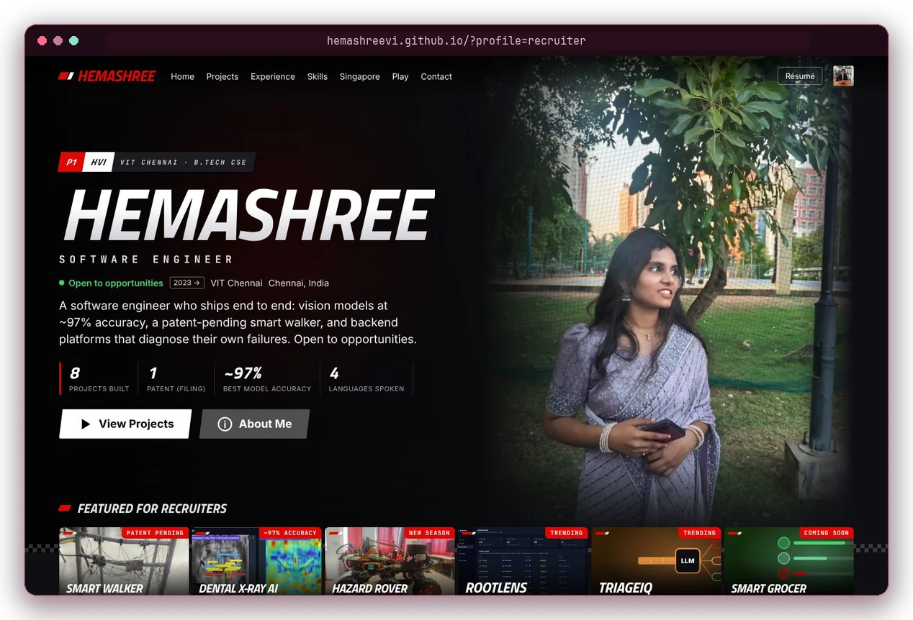</a>

<table>
  <tr>
    <td width="50%">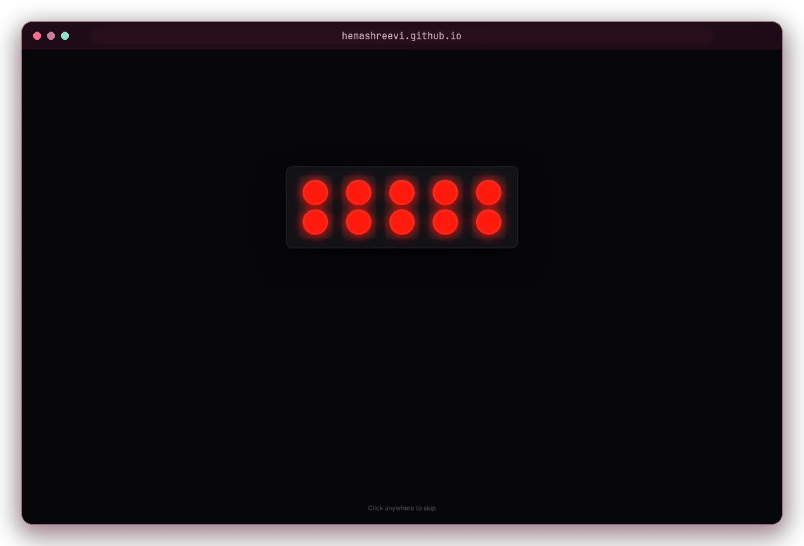<p align="center"><sub><b>Start lights</b> · five reds…</sub></p></td>
    <td width="50%">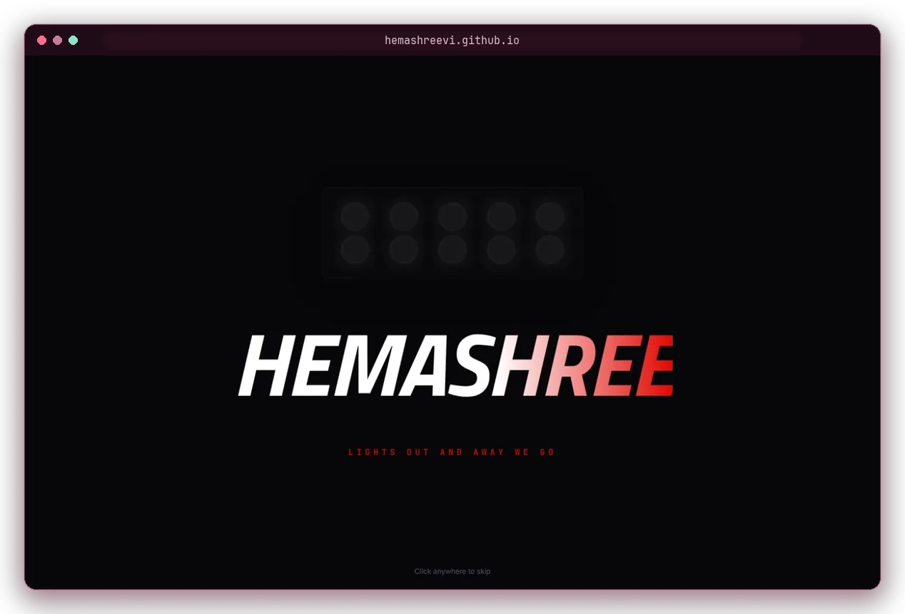<p align="center"><sub><b>Lights out</b> · and away we go</sub></p></td>
  </tr>
  <tr>
    <td>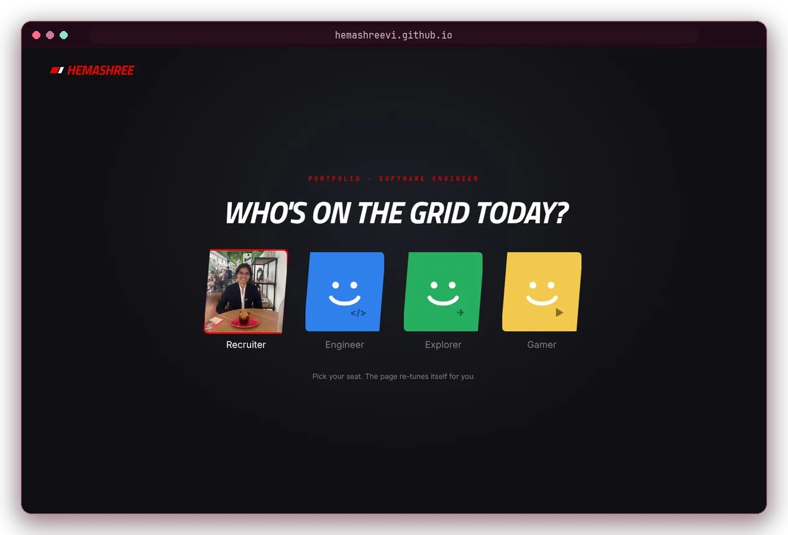<p align="center"><sub><b>Pick your seat</b> · Recruiter, Engineer, Explorer or Gamer</sub></p></td>
    <td>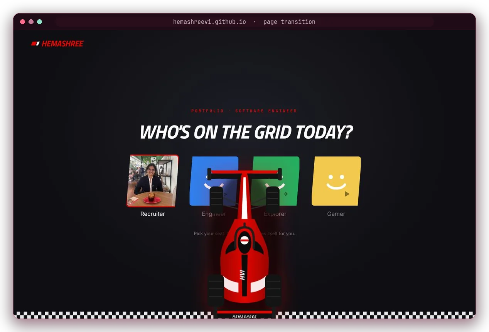<p align="center"><sub><b>F1 transition</b> · the car drives you to the next section</sub></p></td>
  </tr>
  <tr>
    <td>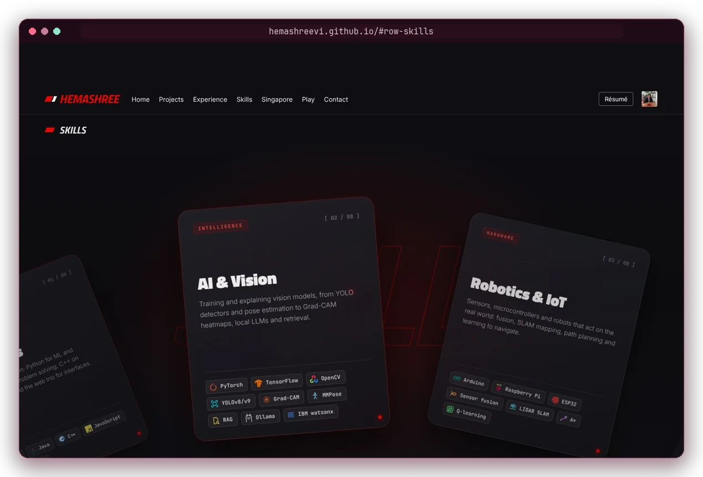<p align="center"><sub><b>Skills arc</b> · cards swing as you scroll</sub></p></td>
    <td>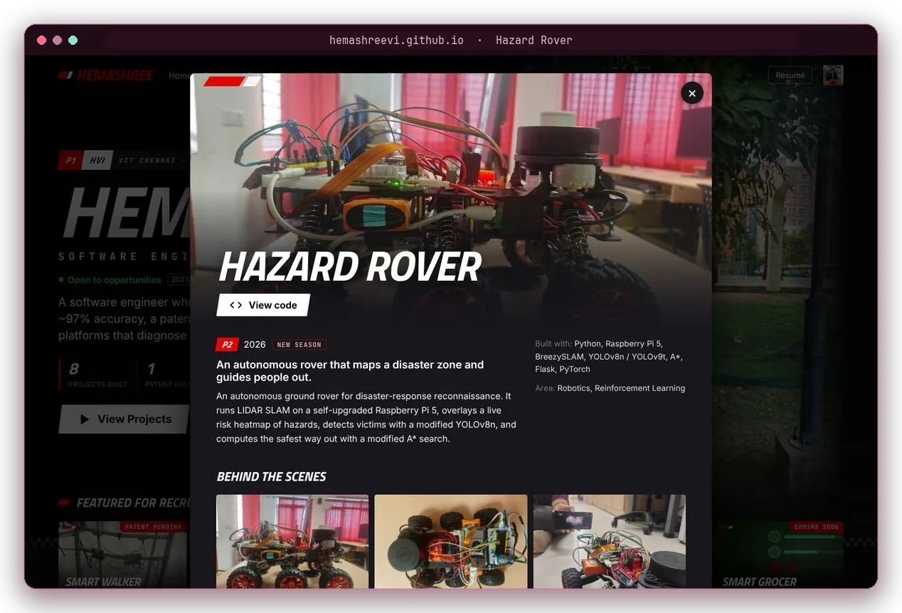<p align="center"><sub><b>Deep dive</b> · highlights, photos and code</sub></p></td>
  </tr>
  <tr>
    <td>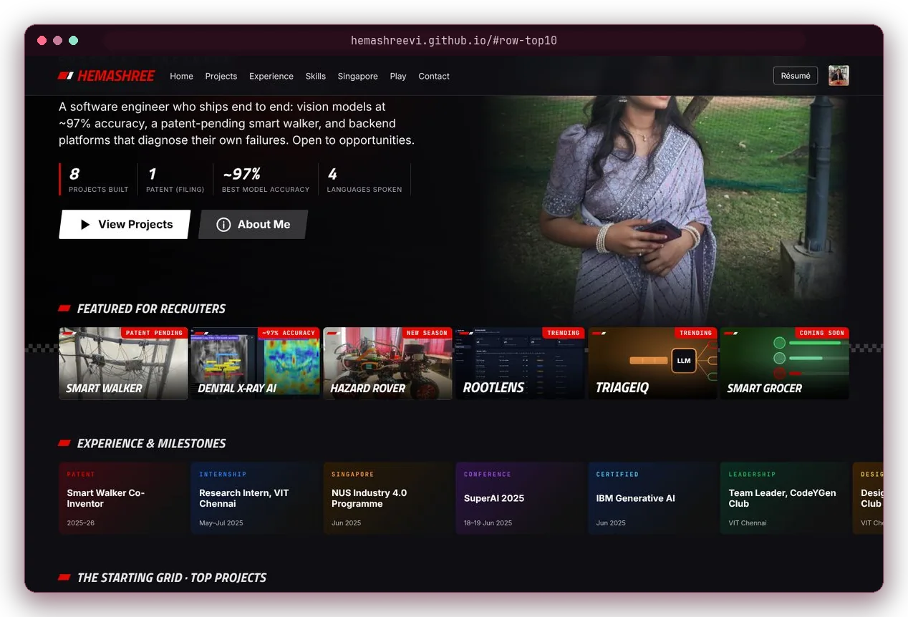<p align="center"><sub><b>Rows</b> · experience and the starting grid</sub></p></td>
    <td align="center">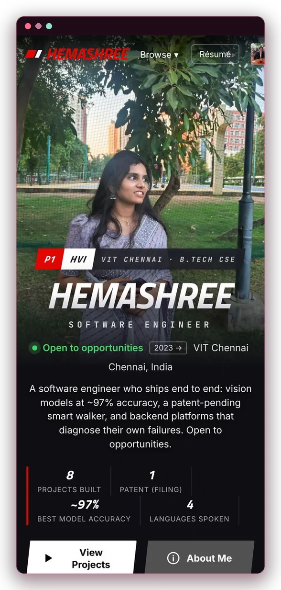<p align="center"><sub><b>Mobile</b> · same race, smaller screen</sub></p></td>
  </tr>
</table>


> 💡 **Tip:** send recruiters `https://hemashreevi.github.io/?profile=recruiter` and they skip straight past the picker.


<p align="center">
  <a href="https://github.com/HemashreeVI/Rover"></a>
  <a href="https://github.com/HemashreeVI/AI_Malocclusion_Detection"></a>
  <a href="https://github.com/HemashreeVI/rootlens"></a>
  <a href="https://github.com/HemashreeVI/TriageIQ"></a>
  <a href="https://github.com/HemashreeVI/smart-grocer"></a>
  <a href="https://github.com/HemashreeVI/JarvisAI"></a>
</p>



```bash
git clone https://github.com/HemashreeVI/HemashreeVI.github.io.git
cd HemashreeVI.github.io && python3 -m http.server 8000   # then open http://localhost:8000
```

**Editing content.** Everything on the home page comes from [`assets/js/data.js`](./assets/js/data.js): projects, photos, experience, skills, the order of rows for each profile. Change it there; there is no build step. After editing CSS or JS, bump the `?v=` number on the three links in `index.html` so visitors get the new files instead of a cached copy.

**Rebuilding this README's art** (needs Python 3 and Pillow):

```bash
python3 scripts/build_readme_cards.py   # animated SVG cards  → assets/readme/cards/
python3 scripts/frame_screens.py        # framed screenshots  → assets/readme/framed-*.webp
```

<details>
<summary><b>⌨️ Classic site shortcuts</b></summary>
<br>

The [classic portfolio](https://hemashreevi.github.io/classic/) keeps the 3D LIDAR hero, the "Hiring for…" switch, the patent blueprint and the four mini-games.

| Key | Action |
|:-:|---|
| <kbd>T</kbd> | Toggle dark / light theme |
| <kbd>D</kbd> | Toggle detection mode |

</details>

<details>
<summary><b>🙏 Credits</b></summary>
<br>

Tech logos come from [Devicon](https://github.com/devicons/devicon) (MIT) and [Simple Icons](https://github.com/simple-icons/simple-icons) (CC0); see [`assets/img/logos/CREDITS.md`](./assets/img/logos/CREDITS.md). The F1 car, posters and README cards are original drawings.

</details>


<p align="center">
  <a href="mailto:shreejith2005@gmail.com"></a>
  <a href="https://www.linkedin.com/in/hema-shree272005"></a>
  <a href="https://leetcode.com/u/hemashree_272005/"></a>
</p>

<a href="https://hemashreevi.github.io"></a>
