<div align="center">



<a href="https://git.io/typing-svg">
  
</a>

<p>
  <a href="https://hemashreevi.github.io"></a>
</p>

<p>
  
  
  
  
  
  
</p>

</div>

---

## ✨ What's inside

The home page is a **streaming-service-style portfolio**:

| | Feature | What it does |
|:-:|---|---|
| 🎬 | **Intro** | The name zooms in before the site opens. Click or press any key to skip. |
| 👤 | **"Who's watching?"** | Pick *Recruiter, Engineer, Explorer* or *Gamer*. The billboard copy and the order of every row change for you. Share `?profile=recruiter` to skip the picker. |
| 🖼️ | **Billboard** | A full-width hero with a spotlight that follows your mouse. |
| 🎞️ | **Rows** | Top picks, a Top 10 of projects, *Continue watching* (what I'm building now), experience, skills, certifications, Singapore 2025 photos and fun facts. |
| 🔎 | **Hover previews** | On desktop, cards expand with match %, genres and quick actions. |
| 📺 | **Detail view** | Every project opens with a synopsis, cast (tech stack), *episodes* (highlights) and *More like this*. |
| 🎮 | **Play Something** | The four mini-games, which open in the classic site. |

The **[classic portfolio](https://hemashreevi.github.io/classic/)** is still there, with the 3D LIDAR hero, the "Hiring for…" switch, Detection mode (<kbd>D</kbd>), the patent blueprint and the games.

## 🎮 Mini-games for visitors

| | Game | Built from | What you do |
|:-:|---|---|---|
| 🦯 | **Keep them standing** | Smart walker patent | Change tilt, weight shift and obstacles, and watch the fall-risk score react |
| 🥭 | **Freshness check** | Smart Grocer | Age a mango and see whether the shop should keep, discount or remove it |
| 🔍 | **Incident hunt** | RootLens | One service broke. Find which one before the errors spread |
| あ | **Hiragana sprint** | My Japanese course | 3D flip cards. Pick the right reading and build a streak |

## 🚀 Projects featured

<div align="center">

| Project | Area | Code |
|---|---|:-:|
| 🦯 **IoT smart walker**, fall-risk prediction · *patent filing in progress* | Embedded & IoT | 🔒 |
| 🤖 **Disaster-response rover**, SLAM, YOLO and safe-path planning | Robotics | — |
| 🦷 **Dental malocclusion detection**, YOLOv9 + Grad-CAM, ~97% accuracy | Computer vision | [](https://github.com/HemashreeVI/AI_Malocclusion_Detection) |
| 🥬 **Smart Grocer**, multimodal produce spoilage detection | Vision + IoT | [](https://github.com/HemashreeVI/smart-grocer) |
| 🔍 **RootLens**, AI-assisted root-cause analysis for microservices | Backend & DevOps | [](https://github.com/HemashreeVI/rootlens) |
| 🎫 **TriageIQ**, real-time LLM support-ticket triage | LLM systems | [](https://github.com/HemashreeVI/TriageIQ) |
| 🛡️ **Intrusion detection & threat modeling** | Security | — |
| 🎙️ **Jarvis**, offline voice assistant | Automation | [](https://github.com/HemashreeVI/JarvisAI) |

</div>

## 🧰 Skills shown on the site

<div align="center">

**Languages**<br/>


**Machine learning & vision**<br/>


**Embedded & robotics**<br/>


**Backend & DevOps**<br/>


**Apps, data & tools**<br/>


</div>

## 🗂️ Repo structure

```
HemashreeVI.github.io/
├── index.html             # streaming-style home page
├── assets/
│   ├── css/site.css       # styles
│   ├── js/data.js         # ALL the content: projects, experience, skills, photos, links
│   ├── js/app.js          # intro, profiles, rows, previews, modals
│   └── img/               # photos and certificates
├── classic/index.html     # the original portfolio, with the mini-games
├── resume.pdf
└── README.md
```

## 💻 Run it locally

```bash
git clone https://github.com/HemashreeVI/HemashreeVI.github.io.git
cd HemashreeVI.github.io
python -m http.server 8000
```
Then open **http://localhost:8000** in your browser.

> 🛠️ **Editing content:** everything on the home page comes from `assets/js/data.js`. Add a project, change a photo or reorder a profile's rows there; no build step needed.

## ⌨️ Shortcuts (classic site)

| Key | Action |
|:-:|---|
| <kbd>T</kbd> | Toggle dark / light theme |
| <kbd>D</kbd> | Toggle detection mode |

---

<div align="center">

### 📬 Let's connect

<a href="mailto:shreejith2005@gmail.com"></a>
<a href="https://www.linkedin.com/in/hema-shree-373622289"></a>
<a href="https://github.com/HemashreeVI"></a>

<br/><br/>

<sub>よろしくお願いします · Made with 💜 by Hemashree V I</sub>

</div>
